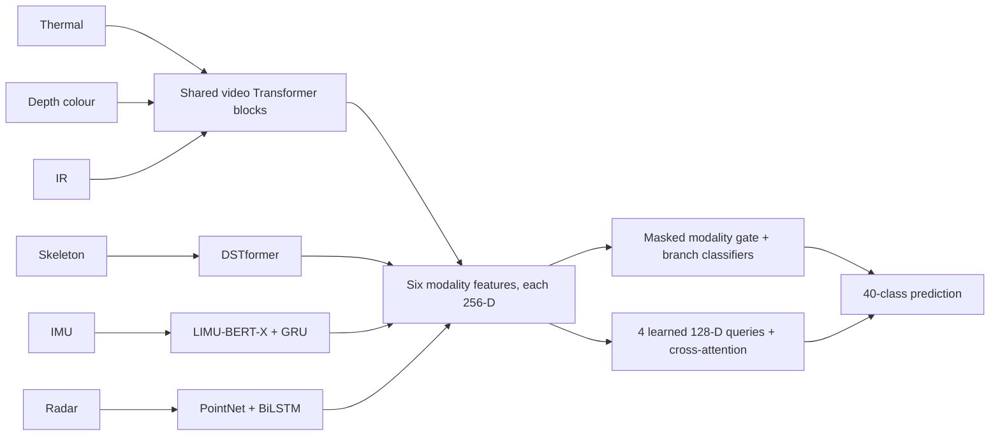

# Efficient Multimodal Human Action Recognition

Team Falcons' CUHK-X Challenge Small Model Track solution, developed at Zhejiang University.

[](LICENSE)

This repository contains the training and inference code for the selected competition model. It combines a shared video backbone with sensor encoders, missing-modality-aware fusion, and a small residual cross-attention module. A fixed second temporal view improves coverage without adding model weights.

## Results

| Inference mode | Local subject-disjoint Top-1 | Kaggle Public |
|---|---:|---:|
| Single temporal view — selected submission V47 | 2,420 / 3,036 = 79.7101% | 0.86567 |
| Two fixed temporal views — selected submission V61 | 2,427 / 3,036 = 79.9407% | **0.87064** |

Local results aggregate held-out predictions from three subject-disjoint folds. Each fold trains on 12 users and validates on six; every clip is evaluated once by a model that did not train on its user. These are validation results, not accuracy on the hidden Kaggle test labels. The final submitted checkpoint was fitted on all 3,036 labelled clips from all 18 training users. The two submissions use the **same checkpoint**.

The complete inference checkpoint is **96,857,179 bytes**, including YOLO11n, below the 100,000,000-byte competition limit. Eligible weights are stored in INT8 and restored to floating point; execution uses BF16 autocast with required FP32 sensor operations. This is storage compression, not end-to-end INT8 execution.

## Method

| Input | Encoder |
|---|---|
| Thermal, depth colour, IR | Public VideoMAEv2 K710 distilled ViT-B student; shared 12 Transformer blocks, separate patch embeddings, output norms and projections |
| IMU, five devices | Public LIMU-BERT-X, shared across devices, with window pooling, bidirectional GRU and projection |
| Skeleton | Small DSTformer adaptation, width 64, one block, two heads; randomly initialized |
| Radar | RadarPointNet/TNet with a two-layer bidirectional LSTM and masked pooling; randomly initialized |



YOLO11n locates the person independently in each camera. Eight probe frames define an expanded clip-level union crop, with a full-frame fallback. Preprocessing caches 32 chronological frames per camera at 224×224; the classifier consumes **16 frames per forward pass**. Missing sensors and invalid time steps have explicit masks.

Training uses fused and per-modality classification, source-user contrastive learning, and masked feature prediction. The latter hides one available modality, recomputes the context without it, and predicts its detached 256-D embedding from the remaining streams. Its small decoder is used only during training.

Dual-view inference selects cached frame indices `1,3,...,31` and `0,2,...,30`. It averages the two 40-class **softmax probability vectors**, with equal weight. Sensor inputs are unchanged. No separately trained model, test-time fitting, pseudo-labels or manual answer corrections are involved.

## Environment

The frozen stack is Linux x86_64, Python **3.10.20**, PyTorch **2.8.0 / CUDA 12.8**, TorchVision **0.23.0**, and Ultralytics **8.3.199**. Inference requires an NVIDIA Ampere-or-newer GPU with native BF16 and a compatible driver. Original verification used RTX 4090 and driver 570.211.01.

```bash
conda env create -f environment.yml
conda activate cuhkx-falcons
sudo apt-get update
sudo apt-get install -y libgl1 libglib2.0-0 zip
python -m pip install -e . --no-deps
python -m pip check
```

Alternatively, create a Python 3.10.20 environment and install `requirements.txt`. The Zhejiang University mirror can be selected with `-i https://mirrors.zju.edu.cn/pypi/web/simple`; retain the pinned versions.

## Data and model access

Challenge data is **not redistributed**. Obtain access through the [CUHK-X dataset organizers](https://aiot-public-dataset-cuhk-x.cuhkaiot.com/) or the [competition data page](https://www.kaggle.com/competitions/cuhk-x-competition-small-model-track/data), and follow its data-use agreement. Keep raw data, decoded arrays and credentials outside Git.

To request the trained model weights, please contact [xiaokj@zju.edu.cn](mailto:xiaokj@zju.edu.cn). Save the checkpoint as `models/model.pt` and verify its SHA-256:

```text
aafbc72913a5664701dec3815d6126ac1cf0846cb8250114567c9de4547ed55e  models/model.pt
```

See [models/README.md](models/README.md). Training initializers can be downloaded independently with `python scripts/fetch_pretrained.py`. That script fetches only public model files and verifies their pinned hashes; it does not download CUHK-X data.

## Inference

Published input layout:

```text
Testing/
  test.csv
  data/
    small_model_track_test.zip
```

An extracted `Testing/data/small_model_track_test/` or `Testing/small_model_track_test/` is also accepted. The manifest needs a `path` column. Its row population and order determine the output.

```bash
# Default: two fixed temporal views; one physical GPU processes four logical shards.
CUDA_VISIBLE_DEVICES=0 bash inference.sh /path/to/Testing outputs/predictions.csv

# Same weights, one temporal view.
CUDA_VISIBLE_DEVICES=0 bash inference.sh /path/to/Testing outputs/single.csv single

# Separately exported research weights, with an optional explicit integrity pin.
CUDA_VISIBLE_DEVICES=0 bash inference.sh /path/to/Testing outputs/research.csv dual \
  --checkpoint /path/to/exported_model.pt --expected-sha256 YOUR_ACTUAL_SHA256
```

Output columns are `path,prediction`, with integer classes 0–39. The wrapper writes a `.run.json` sidecar containing hashes, timings and peak GPU memory. It rebuilds scratch inputs from the supplied raw data, then removes scratch on exit. `CUHKX_SCRATCH_ROOT` selects a writable scratch parent; `PYTHON_BIN` selects the interpreter.

The original network-disabled verification of the frozen package matched all 405 retained predictions and exact CSV bytes. Raw-input dual-view verification took 300.04 seconds on the tested server and peaked at 1.3301 GiB reserved GPU memory. Provisioning 8 GB GPU memory, 16 GB host RAM and 10 GB scratch disk is conservative guidance for that input size. Timings depend on CPU/disk load; memory and latency are not cross-hardware guarantees.

## Training

See [docs/TRAINING.md](docs/TRAINING.md) for the complete cache → source-only IMU fit → joint fit → export sequence, subject folds, and resume commands.

The selected recipe used four GPUs, batch eight per GPU, accumulation two, and effective batch 64. The standalone full-source IMU stage ran 43 epochs; joint full-data fitting ran 20 epochs while preserving a 50-epoch learning-rate schedule. Validation folds must each train their own source-only IMU initializer. All-source IMU weights must never initialize held-user validation.

## Repository and verification

```text
configs/       selected recipes, inference modes, subject-fold protocol
src/cuhkx/     encoders, data decoding, fusion, losses, training and export
src/predict.py portable raw-input inference
scripts/       manifest preparation, portable configuration and asset checks
tests/         release/portability and CPU component checks
third_party/   original license texts and dependency notices
docs/          training, model card, provenance and release validation
```

`docs/SOURCE_MAP.json` records frozen source hashes and public release changes. Fusion, losses, training and checkpoint serialization are unchanged. The public visual adapter starts from the official MIT VideoMAEv2 implementation and preserves the competition API and tensor operations; the older non-commercial VideoMAE adapter and unused ImageBind modules are excluded. Other optional historical encoders remain available but are not selected by the published recipes.

```bash
python scripts/check_release.py
python -m unittest discover -s tests -v
```

See [docs/RELEASE_VALIDATION.md](docs/RELEASE_VALIDATION.md) for the verification results and the scope of the public-source compatibility checks.

## Licensing and acknowledgements

Original Team Falcons contributions are released under **Apache-2.0**. Third-party code and dependencies retain their own terms: the included VideoMAEv2 and LIMU-BERT-X code is MIT, MotionBERT is Apache-2.0, and the external Ultralytics dependency is AGPL-3.0. The dataset and separately supplied model weights have distinct terms. See [LICENSE](LICENSE), [NOTICE](NOTICE), [THIRD_PARTY_NOTICES.md](THIRD_PARTY_NOTICES.md), and the retained upstream texts.

We thank the CUHK-X dataset creators and challenge organizers, and the authors of VideoMAEv2, LIMU-BERT-X, MotionBERT and the other cited components.

**Author:** Kaijie Xiao, Zhejiang University. **Supervisors:** Yi Gao and Wei Dong, Zhejiang University.

Please use `CITATION.cff` to cite this software release and cite the upstream projects separately when applicable.
